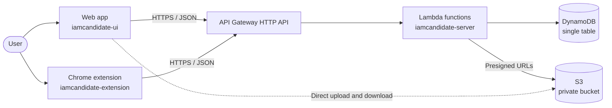

# IamCandidate

**A personal command center for the job search.** IamCandidate brings applications, referrals, interviews, resumes, documents and professional knowledge into one private workspace, and connects it to the browser where the applying happens.

[Live app](https://knot-ui-eight.vercel.app) · [Frontend](https://github.com/GanezhHQ/iamcandidate-ui) · [Backend](https://github.com/GanezhHQ/iamcandidate-server) · [Browser extension](https://github.com/GanezhHQ/iamcandidate-extension)

---

## Overview

A job search is usually spread across spreadsheets, inboxes, job boards, LinkedIn and folders of resume versions. IamCandidate replaces that with a single system of record, and removes repeated work through a browser extension that captures job postings and fills in application forms.

This repository is the entry point to the project. The source code lives in the three repositories below.

## Repositories

| Repository | Purpose | Stack |
| --- | --- | --- |
| [**iamcandidate-ui**](https://github.com/GanezhHQ/iamcandidate-ui) | Web application: dashboard, career tracking, documents, workspace and settings | Next.js 16, React 19, TypeScript, Tailwind CSS 4, shadcn/ui |
| [**iamcandidate-server**](https://github.com/GanezhHQ/iamcandidate-server) | Serverless REST API: authentication, data, file storage, integrations and LaTeX compilation | AWS SAM, Lambda (Node.js 22), API Gateway, DynamoDB, S3 |
| [**iamcandidate-extension**](https://github.com/GanezhHQ/iamcandidate-extension) | Chrome extension: job and referral capture, resume matching and application autofill | Manifest V3, plain ES modules, no build step |

## Capabilities

| Area | What it covers |
| --- | --- |
| **Career** | Applications, companies, contacts, referrals, interviews and a reusable autofill profile |
| **Documents** | Secure file storage and resume management, with LaTeX resume compilation |
| **Workspace** | Projects, tasks, notes and a board view |
| **Knowledge** | Skills, certifications and saved links |
| **Communication** | Email sent through your own SMTP account, drafts and reusable templates |
| **Integrations** | Google Drive and Calendar, GitHub, LinkedIn import and S3 backup |
| **Administration** | User management, access requests and read-only accounts |

### Browser extension

- **Capture jobs** from the current page, with a warning if the job is already saved.
- **Add referrals** from a LinkedIn profile, and draft outreach messages from your templates.
- **Score resume match** against the skills and experience a job asks for.
- **Autofill applications** with your details, resume, work history and saved answers.

Autofill keeps you in control: it never submits a form, never overwrites what you have typed, and leaves passwords and sign-in forms alone.

## Architecture



- **Domain-based functions.** Lambda functions are grouped by domain, such as career, documents, workspace and knowledge.
- **Per-user data isolation.** All records are partitioned by user ID in a single DynamoDB table, so each user sees only their own data.
- **Direct file transfer.** Files move between the browser and a private S3 bucket through presigned URLs.
- **Validated input.** Every path parameter, query string and request body is checked with Zod.
- **Swappable data layer.** The frontend calls typed service contracts, and a build-time setting selects either the live API or an in-browser mock backend.

## Getting started

Clone the repositories side by side:

```bash
git clone https://github.com/GanezhHQ/iamcandidate-ui.git
git clone https://github.com/GanezhHQ/iamcandidate-server.git
git clone https://github.com/GanezhHQ/iamcandidate-extension.git
```

### Frontend only

No backend is needed. Data comes from in-browser mocks.

```bash
cd iamcandidate-ui
npm install
npm run dev
```

The app runs at <http://localhost:3000>.

### Full stack

The server requires Node.js 22 or later. Docker and the SAM CLI are not needed for local development.

```bash
cd iamcandidate-server
npm install
npm run dev
```

The API runs at <http://localhost:3001>, using a local database created on first start. Then, in `iamcandidate-ui`, copy `.env.example` to `.env.local`, set the values below and run `npm run dev`:

```bash
NEXT_PUBLIC_API_MODE=api
NEXT_PUBLIC_API_URL=http://localhost:3001
```

### Extension

1. Open `chrome://extensions` and turn on **Developer mode**.
2. Click **Load unpacked** and select the `iamcandidate-extension` folder.
3. To use a local server, open the extension's **Settings** and set the API URL to `http://localhost:3001`.

## Documentation

| Topic | Link |
| --- | --- |
| API reference | [docs/api.md](https://github.com/GanezhHQ/iamcandidate-server/blob/main/docs/api.md) |
| Data model | [docs/dynamodb-design.md](https://github.com/GanezhHQ/iamcandidate-server/blob/main/docs/dynamodb-design.md) |
| Local development | [docs/local-development.md](https://github.com/GanezhHQ/iamcandidate-server/blob/main/docs/local-development.md) |
| Deployment | [docs/deployment.md](https://github.com/GanezhHQ/iamcandidate-server/blob/main/docs/deployment.md) |
| LaTeX resumes | [docs/latex.md](https://github.com/GanezhHQ/iamcandidate-server/blob/main/docs/latex.md) |
| Google Drive setup | [docs/google-drive.md](https://github.com/GanezhHQ/iamcandidate-server/blob/main/docs/google-drive.md) |

## Project status

IamCandidate is under active development. Inbox sync and AI features are not part of the current backend.

---

Maintained by [GanezhHQ](https://github.com/GanezhHQ).
